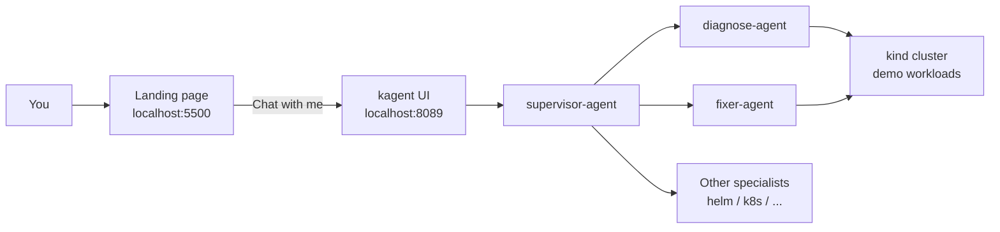

# kagent Cluster Assistant

Natural-language Kubernetes troubleshooting on a local [kind](https://kind.sigs.k8s.io/) cluster, built **on top of** open-source [kagent](https://kagent.dev).

Ask plain-English questions about your cluster. A **supervisor** agent routes each request to specialists that **diagnose** (read-only) or **fix** (patch / apply / create). A small **landing page** acts as the product front door and opens the supervisor chat.

> This repository is **not** a fork of kagent. It contains custom agents, demos, and a landing UI that you layer onto an upstream kagent install.

---

## Features

- **Supervisor front door** — one chat entry; no need to pick among many specialist cards
- **Least-privilege agents** — `diagnose-agent` (read-only) vs `fixer-agent` (write tools)
- **Optional chaining** — e.g. list unhealthy pods → diagnose → fix in one ask
- **Visible routing** — replies start with `Routed to: …`
- **Landing page** — static front page that links into supervisor chat
- **Reproducible demos** — break `hello` with a bad image (`ImagePullBackOff`) and recover via chat

---

## Architecture



**Flow in words**

1. Open the landing page (static HTML).
2. Click **Chat with me** → kagent supervisor chat.
3. Supervisor routes (and may chain) to diagnose / fixer / other agents.
4. Agents use tools against the Kubernetes API; the LLM reasons over the results.

```text
You → Landing (:5500) → kagent UI (:8089) → supervisor
                                              ├─ diagnose-agent  (read tools)
                                              ├─ fixer-agent     (read + write)
                                              └─ optional stock specialists
                                                      ↓
                                                 kind cluster
```

---

## Repository layout

```text
.
├── README.md                 # This file
├── agents/
│   ├── diagnose-agent.yaml   # Read-only troubleshooting agent
│   ├── fixer-agent.yaml      # Remediation agent (patch/apply/create)
│   └── supervisor-agent.yaml # Router / front door
└── landing/
    ├── index.html            # Front page
    ├── styles.css
    └── config.js             # Supervisor chat URL
```

---

## Tech stack

| Layer | Choice |
|--------|--------|
| Local cluster | kind + Docker |
| Agent platform | [kagent](https://github.com/kagent-dev/kagent) 0.9.x (Helm) |
| LLM (this lab) | Anthropic Claude (other providers supported by kagent) |
| Custom agents | Declarative kagent `Agent` CRs |
| Landing page | Static HTML/CSS + Python `http.server` (or any static host) |

---

## Prerequisites

- Docker
- [kind](https://kind.sigs.k8s.io/)
- `kubectl`
- Helm 3
- An LLM API key (Anthropic used below; OpenAI / Gemini / Ollama also possible via kagent)

---

## Quick start

### 1. Create a kind cluster

```bash
kind create cluster --name kagent-lab
kubectl get nodes
```

### 2. Install upstream kagent

Pin **0.9.9** if you are on a similar Kubernetes version to this lab (kind ~1.32).

```bash
export ANTHROPIC_API_KEY='your-key-here'

helm install kagent-crds oci://ghcr.io/kagent-dev/kagent/helm/kagent-crds \
  --version 0.9.9 \
  --namespace kagent \
  --create-namespace

helm install kagent oci://ghcr.io/kagent-dev/kagent/helm/kagent \
  --version 0.9.9 \
  --namespace kagent \
  --set providers.default=anthropic \
  --set providers.anthropic.apiKey=$ANTHROPIC_API_KEY

kubectl -n kagent get pods
```

Wait until core pods (controller, UI, tools) are Ready.

### 3. Apply this repo’s custom agents

```bash
git clone https://github.com/saneja1/kagent-cluster-assistant.git
cd kagent-cluster-assistant

kubectl apply -f agents/diagnose-agent.yaml
kubectl apply -f agents/fixer-agent.yaml
kubectl apply -f agents/supervisor-agent.yaml
```

### 4. Create a demo app (optional)

```bash
kubectl create namespace demo --dry-run=client -o yaml | kubectl apply -f -
kubectl -n demo create deployment hello --image=nginx:1.27
```

### 5. Open kagent UI + landing page

**Terminal A — kagent UI tunnel**

```bash
kubectl -n kagent port-forward service/kagent-ui 8089:8080
```

**Terminal B — landing page**

```bash
cd landing
python3 -m http.server 5500 --bind 0.0.0.0
```

| URL | What |
|-----|------|
| http://localhost:5500 | Landing page (front door) |
| http://localhost:8089/agents/kagent/supervisor-agent/chat | Supervisor chat (direct) |

If your supervisor URL differs, edit `landing/config.js`.

---

## Demo script

Break the app:

```bash
kubectl -n demo set image deployment/hello nginx=nginx:wrong-image-xyz
kubectl -n demo get pods
```

Ask the **supervisor** (via landing page or direct chat):

| Goal | Example prompt | Expect |
|------|----------------|--------|
| Diagnose only | What’s wrong with hello in demo? Don’t change anything. | `Routed to: diagnose-agent` |
| Fix | Fix hello in demo with image nginx:1.27. Do not add containers. | `Routed to: fixer-agent` |
| Chain | Check pods in demo. If unhealthy, diagnose, then fix with nginx:1.27. | `Routed to: diagnose-agent, fixer-agent` |

Verify in the terminal:

```bash
kubectl -n demo get pods
```

You want `hello` at **`1/1 Running`**.

---

## Custom agents (summary)

| Agent | Role | Tools (idea) |
|--------|------|----------------|
| **diagnose-agent** | Read-only root-cause analysis | get / describe / events / logs / YAML |
| **fixer-agent** | Apply small fixes + verify | reads + patch / apply / create |
| **supervisor-agent** | Route & optionally chain | other agents (no raw k8s tools) |

Design choice: **separate read vs write** so diagnosis does not require cluster-mutating permissions.

---

## Troubleshooting

| Symptom | Likely cause | What to do |
|---------|--------------|------------|
| `localhost:5500` refused | Landing server not running | Start `python3 -m http.server 5500` in `landing/` |
| `localhost:8089` refused | Port-forward stopped | Re-run UI `port-forward` |
| Port 8089 already in use | Old forward still alive | Use it, or free the port / use `8090:8080` |
| Agent says fixed but pod still bad | Premature success / bad patch | Trust `kubectl get pods`; recreate deploy if needed |
| Agents not Ready | Still starting | `kubectl -n kagent get pods` and wait |

---

## What this project is / isn’t

| Is | Isn’t |
|----|--------|
| Multi-agent design on kagent | A rewrite of the kagent platform |
| Custom Agent YAMLs + landing UI | A production multi-tenant SaaS |
| A kind-based learning / portfolio lab | A replacement for human on-call judgment |

---

## Credits

- Platform: [kagent](https://github.com/kagent-dev/kagent) (Apache-2.0)
- Local cluster: [kind](https://kind.sigs.k8s.io/)
- Model provider used in this lab: Anthropic Claude

---

## License

Custom agents and landing page in this repository: add your preferred license when publishing (e.g. MIT). Upstream kagent remains under its own license.
